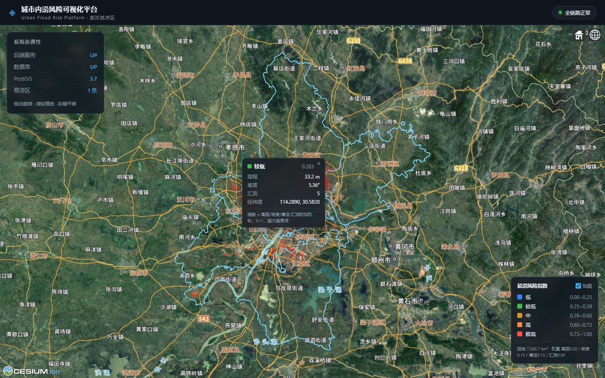

# 点击查询：从屏幕像素到栅格里的一个格子（M4）

> 这篇讲的是一个完整的全栈功能：在地球上点一下，弹出这一点的易涝指数。
> 涉及 Python（导出数据）、Java（按坐标取字节）、Vue（换算屏幕坐标）。
> 全程没有数据库，因为这件事不需要数据库。

---

## 一、需求拆成四步

```
① 鼠标点一下
     ↓  屏幕像素 (x, y)
② Cesium 反算经纬度
     ↓  lon, lat
③ HTTP 请求后端
     ↓  GET /api/flood-index?lon=..&lat=..
④ 经纬度 → 行列号 → 读 16 个字节
     ↓  index / elev / slope / acc
⑤ 弹卡片
```

每一步都有一个坑，下面逐个说。

---

## 二、为什么不直接在 Java 里做投影

我们的成果网格是 **EPSG:4547**（CGCS2000 3 度带，单位米），而浏览器给的是 **WGS84 经纬度**。

最直觉的做法是在 Java 里再实现一遍高斯-克吕格投影。但那样要引入 proj4j 之类的库、要处理带号、要保证和 Python 侧（pyproj）算得一模一样——**每多一处实现，就多一处可能不一致的地方**。

换个位置解决：**在 Python 侧把网格重采样到经纬度**。

```python
reproject(source=index, src_transform=tr4547, src_crs="EPSG:4547",
          dst_transform=tr4326, dst_crs="EPSG:4326",
          resampling=Resampling.nearest)
```

这样后端只剩一个线性公式，没有三角函数、没有椭球参数：

```
col = (lon - west) / (east - west) * width
row = (north - lat) / (north - south) * height
```

代价是精度从 30 m 降到约 90 m（3 角秒）。但屏幕上那张贴图本身就是 120 m 的——**点击得到的值和看到的值是同一档精度**，不会互相矛盾。

> 一个经验：**能在数据准备阶段解决的事，不要留到运行时**。
> 运行时每多一步换算，就多一个在生产环境里才暴露的 bug。

---

## 三、二进制布局（前后端契约）

```
wuhan_flood_index_grid.bin    44.3 MB
wuhan_flood_index_grid.json   头文件
```

**布局**：行优先（row-major），每格 4 个 float32 紧挨着，小端序。

```
offset = (row * width + col) * 16
         └─────────────┘
         第几个格子        每格 16 字节
```

```
格子 (0,0)          格子 (0,1)          格子 (0,2)
[index][elev][slope][acc][index][elev][slope][acc][index]...
 ← 4 字节 →          ← 16 字节 →
```

**为什么用二进制而不是 JSON/CSV**：

| | 大小 | 取一格 |
|---|---|---|
| JSON | 200 MB+ | 全读进内存再找 |
| CSV | 120 MB | 逐行扫 |
| **二进制** | **44 MB** | **seek 到偏移，读 16 字节** |

277 万个格子，二进制是唯一能让"随机访问"变成一次乘法 + 一次读的方案。

**为什么把 `index` 单独做掩膜**：市域外和水体的 index 写成 `NaN`。
"没数据"和"低风险"是两件事——江面上不该显示"低风险 0.1"，应该说"这里不评价"。
另外三个通道（高程/坡度/汇流）保留原值，所以点到湖面上仍然能告诉你"这是水面，高程 26.9 m"。

---

## 四、两个必须理解的坑

### 坑 1：行的方向（y 轴翻转）

图像的第 0 行在**最北**边，纬度越大、行号越小。

```java
row = (north - lat) / (north - south) * height;   // 对
row = (lat - south) / (north - south) * height;   // 错！上下颠倒
```

写错了**不会报错**，值也"像那么回事"（武汉南北高差不大，读到的还是几十米的高程），
所以这种 bug 能活很久。唯一的发现方式是**拿已知地标对**：

| 地标 | 经纬度 | 期望行号 | 期望高程 |
|---|---|---|---|
| 江汉路 | 114.289, 30.582 | 935 | 33.2 m |
| 木兰山 | 114.380, 31.100 | 313 | 226.6 m |

木兰山在江汉路**北**边 57 km，行号必须**更小**（313 < 935）。这一条就能验出来。

### 坑 2：字节序

numpy 写的是**小端**，Java 的 `DataInputStream.readFloat()` / `ByteBuffer` 默认是**大端**。

直接读会得到 `1.4E-38` 这种数——不抛异常，只是数据全错。必须显式：

```java
ByteBuffer buf = ByteBuffer.allocate(16).order(ByteOrder.LITTLE_ENDIAN);
```

> "读出来是垃圾但不报错"是二进制处理里最常见的事故。

---

## 五、Java 怎么读

```java
long offset = ((long) row * width + col) * BYTES_PER_CELL;
ByteBuffer buf = ByteBuffer.allocate(16).order(ByteOrder.LITTLE_ENDIAN);
channel.read(buf, offset);          // 定位读：不移动文件指针
```

**为什么用 `FileChannel.read(buf, position)` 而不是 `RandomAccessFile.seek()`**：

`seek` 会移动文件指针，两个请求同时来就会互相踩（一个 seek 完还没读，另一个把指针挪走了）。
`read(buf, position)` 是**定位读**，不改变指针，天然线程安全。

44 MB 的文件没有读进内存，操作系统会做页缓存，连续点击时第二次开始就是内存速度。

---

## 六、前端的两次换算

```js
// ① 屏幕像素 → 三维坐标：从相机穿过这个像素打一条射线，求与椭球面的交点
const cartesian = viewer.camera.pickEllipsoid(
  movement.position, viewer.scene.globe.ellipsoid)

// ② 三维坐标 → 经纬度（弧度制）
const carto = Cesium.Cartographic.fromCartesian(cartesian)
const lon = Cesium.Math.toDegrees(carto.longitude)
```

`pickEllipsoid` 求的是**椭球面**，不是真实地面。我们没开地形，两者一致；
将来接了三维地形，要换成 `viewer.scene.globe.pick(ray, scene)`，否则点到山坡上会取到山脚。

**卡片位置**：跟着鼠标走（点击点右下 16 px），靠边时往回缩。
没做"相机移动时跟随"——那需要每帧重算屏幕坐标，收益不大。

---

## 七、怎么自测（不用点鼠标）

把查询逻辑抽成一个函数，就能直接用固定坐标调：

```js
queryAt(114.289, 30.582, 560, 300, Cesium.Cartesian3.fromDegrees(...))
```

实测结果和 Python 基准**逐位一致**：

```
江汉路    row=935 col=704  index 0.283  elev 33.2  slope 5.36  acc 5
木兰山    row=313 col=813  index 0.186  elev 226.6 slope 6.82  acc 12
汤逊湖    row=1129 col=777 index 0.730  elev 26.9  slope 0.00  acc 99
孝感界外  row=529 col=297  index NaN（不参与评价）
```



> **能被固定输入的验证，才算验证过。** 靠"点一下看着还行"是不够的。

---

## 八、遗留问题

| 问题 | 影响 | 下一步 |
|---|---|---|
| 90 m 分辨率 | 街道级点击会取到邻格的坡度，城区 DSM 噪声明显 | 提高网格分辨率，或改用 30 m 原网格 + 运行时投影 |
| 湖面仍可能判高 | 汤逊湖 0.730"极高"（高程 26.9 m 躲过 22 m 的水体门槛） | 用 ESA WorldCover / OSM 水面替换高程判据 |
| 卡片不跟随相机 | 旋转地球后卡片停在原屏幕位置 | 监听 `camera.changed` 自动收起，或改挂 Entity.label |
| 只查单点 | 不能框选一片区域统计 | 加 `/api/flood-index/stats?bbox=...`，服务端遍历 |

---

## 九、这个功能为什么值得写进简历

它把三件不同层次的事串在了一条链上：

1. **数据工程**：栅格重采样、掩膜、二进制序列化、单一数据源
2. **后端**：文件随机访问、线程安全的定位读、字节序、三种状态码的语义
3. **前端**：三维场景的屏幕坐标反算、事件生命周期（handler 必须 destroy）

面试里问"你怎么做的"时，能讲清"为什么要换到经纬度格网"和"行号为什么是 north 减 lat"，
比说"我调了个 Cesium 的 API"有说服力得多。
